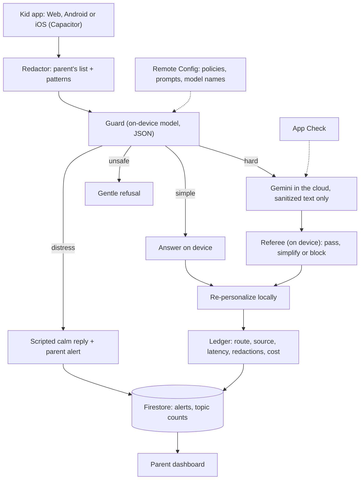

# Sprout: the AI you can hand your kid

A Gemini-powered assistant that a parent can safely give to a 6-12 year old. A small model on the device acts as the child's guardian: it strips identity before anything leaves the tablet, answers simple questions offline, checks every cloud answer for age fit, and catches distress. The big cloud model only ever sees a sanitized question.

Built for Google #BuildHybridAI 2026 with **Firebase AI Logic hybrid inference** (Gemini Nano or Apple's on-device model, plus Gemini in the cloud).

**Try it live:** https://buildhybridai-c1694.web.app (tap "Try a sample family" to see the kid and parent views without an account).

## The problem
Kids already use general-purpose AI, and the safeguards are not keeping up.

- Nearly 90% of children use AI ([Common Sense Media](https://www.commonsensemedia.org/articles/nearly-90-of-children-are-using-ai-are-we-prepared-for-what-this-means)).
- On Oct 7 2026 Common Sense rated ChatGPT for Teens an "unacceptable risk": it missed more than 1 in 4 warranted crisis referrals, and its parental controls cannot show conversations ([Axios](https://axios.com/2026/10/07/chatgpt-teens-safety-risk-common-sense-media), [ABC30](https://abc30.com/story/guardrails-openais-chatgpt-teens-dont-work-promised-watchdog-group-says/19922264/)).
- Gemini for under-13s needs a parent to switch it on in Family Link ([Notebookcheck](https://notebookcheck.net/chatgpt-gemini-meta-ai-what-parents-can-control-in-ai-chatbots.1445374.0.html)), and none of these products has an on-device privacy layer between the child and the cloud.
- Policy is moving: Common Sense and OpenAI back the [Parents & Kids Safe AI Act](https://www.commonsensemedia.org/press-releases/common-sense-media-openai-join-forces-on-strongest-youth-ai-safety-measure-in-us).

The buyer is the parent; the user is the child.

## How it works: what runs where
| Job | Runs on | Why |
|---|---|---|
| Strip the child's identity (name, school, city, friends, phone, email, address) | Device | An identity must never reach any cloud. Deterministic rules plus the parent's setup list, then a model pass |
| Safety and intent guard on every message | Device model (JSON output) | Runs on every message, so it must be free, instant and private |
| Simple answers, spelling, "what is" questions | Device model | Works offline, costs nothing |
| Hard "why/how" answers, stories, homework help | Cloud (Gemini), sanitized text only | Needs a bigger model |
| Referee: is the cloud answer right for this age? | Device model | The guardian checks the big brain before the child sees anything |
| Distress (sad, scared, being hurt, online danger) | Deterministic calm script, a "talk to a trusted adult" prompt, and a parent alert. No generation | Critical paths stay predictable |
| Weekly parent digest | Cloud, built from topic labels and counts only, never transcripts | Respects the child's privacy too |

Every answer carries a badge (answered on the device, or asked the big brain) read from the SDK's real inference source, and the parent sees a Safety Ledger of routes, redactions and estimated cost.

## How Firebase AI Logic hybrid inference is used
One platform-neutral interface, [`AiClient`](app/src/ai/types.ts), has one implementation per platform. All of them use hybrid mode per task: `prefer_device` for the guard and simple answers, `prefer_cloud` or `only_cloud` for hard questions, `only_device` where nothing may leave the device. Each result reports `source` (`device` or `cloud`) from the SDK, not a guess.

| Platform | Implementation | SDK call |
|---|---|---|
| Web | [`app/src/ai/firebaseWeb.ts`](app/src/ai/firebaseWeb.ts) | `getGenerativeModel` with `InferenceMode.PREFER_ON_DEVICE` etc., `initializeDeviceModel()` on a user gesture, `inferenceSource` on the response |
| Android | [`native/android/SproutAiPlugin.kt`](native/android/SproutAiPlugin.kt), bridged by [`app/src/ai/capacitorAi.ts`](app/src/ai/capacitorAi.ts) | `OnDeviceConfig(mode = InferenceMode.PREFER_ON_DEVICE)`, `FirebaseAIOnDevice.checkStatus()` and `download()`, `inferenceSource` |
| iOS | [`native/ios/SproutAiPlugin.swift`](native/ios/SproutAiPlugin.swift), same bridge | `HybridModel(primary: SystemLanguageModel.default, secondary: Gemini)`, source from `rawResponse.modelVersion` (Firebase Apple SDK pinned to 12.x) |
| Tests and demo | `FakeAi` in [`app/src/pipeline/testing.ts`](app/src/pipeline/testing.ts), [`app/src/ai/demoAi.ts`](app/src/ai/demoAi.ts) | Scripted responses, no keys needed |

The pipeline in [`app/src/pipeline/`](app/src/pipeline/) is pure TypeScript with no Firebase or DOM imports, so the same code runs on web, inside Capacitor, and in unit tests.

## Privacy guarantee
The parent's setup supplies the known identifiers (child's name, nicknames, school, city, friends, teachers, places). They are redacted deterministically before any model runs, together with patterns for phone numbers, emails and addresses, and the on-device model looks for what is left. The guarantee does not depend on model quality, and it is measured, not claimed.

[`docs/EVAL.md`](docs/EVAL.md) is generated by `pnpm eval` over synthetic questions, in the worst case: every question is forced to the cloud, with and without an on-device model, and with the model's own name detection switched off.

Two blind sets were written by separate authors who never saw the rules. Their **first** measurement (before any fix they informed) is the honest baseline, recorded in [`docs/EVAL-HISTORY.md`](docs/EVAL-HISTORY.md):

| Blind set, first measurement | Private details that reached the cloud | Urgent distress caught | Concern caught | False alarms |
|---|---|---|---|---|
| Blind v1 (121 questions) | 5 of 47 | 4 of 15 | 8 of 10 | 1 of 96 |
| Blind v2 (151 questions) | 4 distinct of 70, all names the parent never entered | 11 of 16 | 4 of 9 | 0 of 126 |

Each miss was then fixed by category (curly apostrophes, school initials, birthdays, Hinglish, indirect abuse and grooming phrasing, "my little sister X", titles like "Coach X"), not item by item. Current results on all three sets (development 201, v1 121, v2 151): **0 private details reach the cloud, every distress case is caught, 0 false alarms.** Because v1 and v2 informed those fixes, the current numbers are optimistic; a third blind set is measured before submission. The development set gates the build (zero leaks is asserted).

All evaluation data is **synthetic**: invented kids, schools, phone numbers and addresses (reserved `example.com` domains and 555 phone ranges). No real person's data is used anywhere in this repo.

## Architecture

The child's real identifiers and transcripts are not synced to Firestore: only an alias, topic labels, counts and alerts are.

## Firebase products used
- **AI Logic**: hybrid inference (on-device plus Gemini in the cloud) on all platforms.
- **App Check**: reCAPTCHA Enterprise on web, Play Integrity and App Attest on native, debug providers for development.
- **Authentication**: parent sign-in with Google; the child's device is paired with a family code.
- **Cloud Firestore**: family settings, alerts and weekly counts, with offline persistence as the queue ([`firebase/firestore.rules`](firebase/firestore.rules)).
- **Remote Config**: age-band policies, prompts, JSON schemas, model names and routing thresholds.
- **Hosting**: the web app.

## Platform status
| Platform | Status |
|---|---|
| Web | Working: kid app, parent dashboard, hybrid AI client, demo mode |
| Android | Plugin sources and setup guide written ([`native/android`](native/android)); build and device run in progress |
| iOS | Plugin sources and setup guide written ([`native/ios`](native/ios)); build and device run in progress |

Lines marked `VERIFY:` in the native sources are API names that were not printed in the official docs and still need a compiler check.

## Run it
Needs Node and [pnpm](https://pnpm.io). Run from `app/`:

```
pnpm install
pnpm dev
```

With no Firebase keys, `pnpm dev` starts in **demo mode**: a scripted AI stands in for the models, so the whole kid and parent flow can be tried without any account. For the real thing (Firebase project, AI Logic, App Check, Auth, Firestore, and the Chrome on-device model) follow [`docs/SETUP.md`](docs/SETUP.md).

## Tests and eval
From `app/`:

```
pnpm exec tsc --noEmit -p .   # type check
pnpm test                     # 100 unit tests: redaction, distress, pipeline fail-closed paths, PIN, ledger, model JSON parsing, remote policy
pnpm eval                     # privacy and safety eval over 473 synthetic questions; rewrites docs/EVAL.md
pnpm e2e                      # 53 end-to-end checks in headless Chrome (needs Chrome installed)
```

The end-to-end suite builds the app, drives the real UI and fails on any console error. It checks:
- the sample family, the device and cloud routing, and the "What the big brain saw" panel;
- the offline-to-online upgrade;
- care replies for distress, including curly apostrophes;
- the parent gate and PIN with lockout, and that safety alerts survive "clear history";
- axe accessibility on every screen in light and dark mode;
- no horizontal scrolling at 360, 390 and 1280 px.

Evaluation questions live in [`shared/eval/questions.jsonl`](shared/eval/questions.jsonl) (development), [`shared/eval/heldout.jsonl`](shared/eval/heldout.jsonl) (blind v1) and [`shared/eval/heldout2.jsonl`](shared/eval/heldout2.jsonl) (blind v2).

## Docs
[`docs/PLAN.md`](docs/PLAN.md) (product and plan) | [`docs/SETUP.md`](docs/SETUP.md) (Firebase and Chrome setup) | [`docs/EVAL.md`](docs/EVAL.md) (privacy and safety numbers) | [`docs/HANDOFF.md`](docs/HANDOFF.md) (status)

## License
Apache-2.0, see [`LICENSE`](LICENSE).
