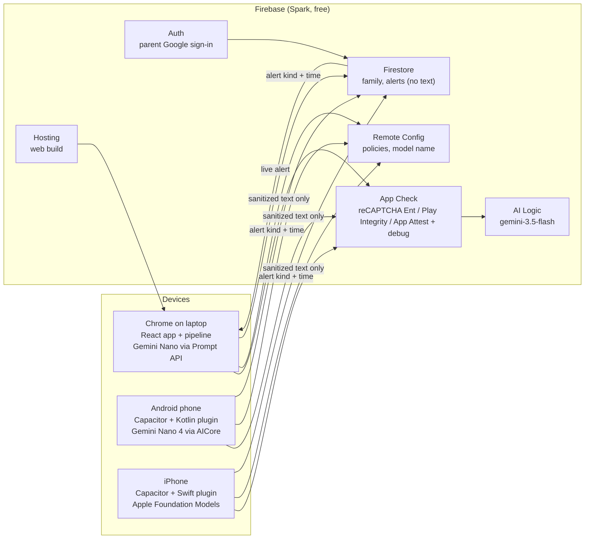
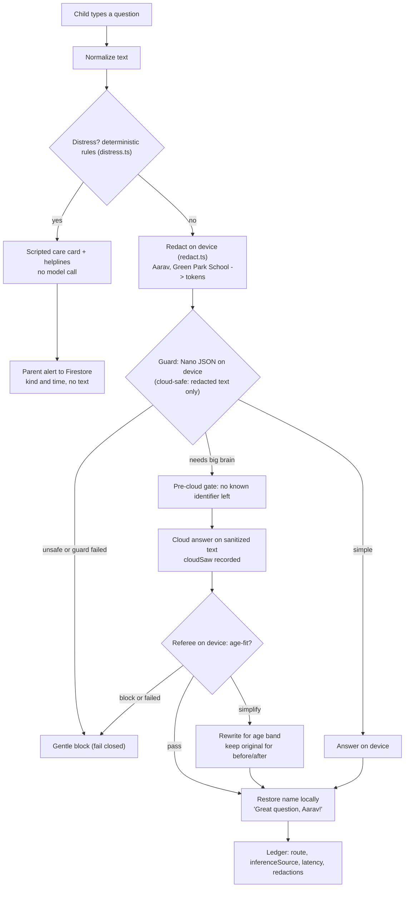
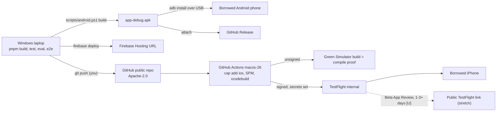
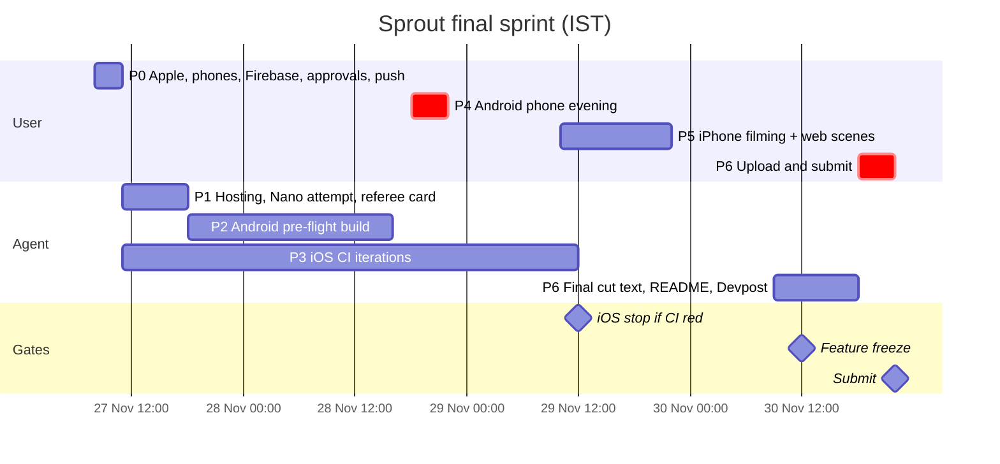

# Sprout: the winning plan (read this first)

Written 2026-11-26 night IST by the architect agent. Deadline: Nov 30 2026, 2:00 PM PT = **Dec 1, 3:30 AM IST**. We submit by **Nov 30, 10 PM IST**.
Reviewed 2026-11-26 night IST by the reviewer agent against the repo (git status, git diff) and research. Round 1 builder changes were then code-reviewed (3 important bugs fixed, including a privacy gate on the cloud retry), tested (tsc clean, 70/70 unit tests, build OK) and committed locally in 1f33623. Not pushed.
Source keys used below: JV = research/overnight/judge-verdict.md, CH = research/overnight/chrome.md, AN = research/overnight/android.md, IO = research/overnight/ios.md, CO = research/overnight/competitors.md, R01 = research/01-hackathon-rules-summary.md. [U] = not verified.

## 1. The pitch and how we win

**One sentence:** "Sprout is the AI you can hand your kid: a small AI on the device guards a big AI in the cloud, so your child's name never leaves the phone, every cloud answer is checked for their age, and if they are hurting, you hear about it, not a server." (JV section 5)

Why Sprout wins:
- **Nobody else has the referee.** At least 8 entries strip personal data before the cloud. None lets the small model check and rewrite the big model's answer for a child's age. None has a deterministic distress path with a parent alert (CO section 2).
- **Hard numbers, not claims.** Blind v3 first measurement (rules only): 47 of 65 details kept on device, urgent 12/16, 1/110 false alarms; after category fixes 0 leaks across 623 questions (optimistic, labelled so). See sprout/docs/EVAL-HISTORY.md. We add measured phone numbers (latency, % on device) on Nov 28.
- **One safety pipeline, three platforms.** The same TypeScript engine (sprout/app/src/pipeline) runs on Chrome, Android and iOS. Multi-platform gets "strong consideration" for the Grand Prize (R01).

Target prizes (R01 prize table, JV section 1):
| Prize | Cash | Our plan |
|---|---|---|
| Grand Prize | $10,000 | Main goal. Score now about 3.25, after this plan about 4.0 (4.5 with real Android and iPhone footage) |
| Best Android | $3,000 | **Primary "Best of".** APK already builds; one borrowed Nano 4 phone evening gives real on-device footage |
| Best iOS | $3,000 | Bonus. Thin field, but three unknowns stack: Swift never compiled, Apple enrollment, Beta Review |
| Best Web/Chrome | $3,000 | Fallback only if no Android phone appears. Web is the most crowded track (CO section 3) |

A project can win the Grand Prize plus one "Best of" (R01).

## 2. The solution per platform

The engine is the same everywhere. What changes is the AI adapter behind `AiClient` (sprout/app/src/ai/types.ts). sprout/app/src/state.tsx:45-48 picks it: `CapacitorAi` on a phone built with `VITE_NATIVE_FIREBASE=true`, `DemoAi` with no Firebase keys, else `LazyFirebaseAi` (web).

### Chrome (web)
- **Judge sees:** the kid chat with badges "Sprout knew this!" (device) or "Asked the big brain" (cloud), the "What the big brain saw" split view, the parent dashboard and alerts (HANDOFF "Done").
- **On device:** deterministic redaction and distress (pure TS), plus Gemini Nano through the Firebase JS SDK hybrid API for guard, simple answers and referee (sprout/app/src/ai/firebaseWeb.ts). If Chrome has no Nano, a "cloud-safe mode" banner shows and the guard runs in the cloud on already-redacted text only (sprout/app/src/pipeline/sprout.ts:158).
- **In the cloud:** gemini-3.5-flash for hard "why" answers on sanitized text; weekly digest from counts only (PLAN.md "Why hybrid").
- **Status today:** works in Demo mode; 66 unit tests at the last recorded run, e2e 53/53 (HANDOFF lines 136-142). Now 70/70 unit tests after the overnight fixes (4 new in `sprout/app/src/ai/firebaseWeb.test.ts`). No real AI Logic call has ever run; no hosted URL (JV section 1). Laptop Nano probably fails the >4 GB GPU / 16 GB RAM bar without the bypass flag (CH section 2).
- **Done overnight (reviewed, tested, committed 1f33623):** "Run on device" disabled until the model is available (DeviceCheck.tsx, CH bug 1); status polling every 4 s while `downloading` (state.tsx, CH bug 2); `prefer_device` retries once in the cloud when the on-device call throws (always behind the privacy gate, sprout.ts), and a missing `inferenceSource` now throws instead of being guessed (firebaseWeb.ts).
- **Also done overnight (committed 3b86285):** referee before/after (raw cloud answer vs the guardian rewrite, grown-ups section of the kid panel and parent Activity, visible in Demo mode on the World War 2 sample); hand-written service worker so the hosted app reloads offline. The cloud retry privacy gate is confirmed by the code reviewer. Unit 73/73, e2e 53/53.
- **Left:** Firebase setup and Hosting deploy; Nano bypass attempt.

### Android (primary)
- **Judge sees:** the same app on a real Nano 4 phone in a child's hands: device badge with latency, airplane mode still answering, referee before/after, distress card with the alert arriving on the laptop 2 s later (JV section 4).
- **On device:** Gemini Nano 4 through AICore, via the Kotlin plugin using firebase-ai-ondevice (sprout/native/android/SproutAiPlugin.kt; registered in MainActivity, AN section 4).
- **In the cloud:** same gemini-3.5-flash via firebase-ai; source read from `inferenceSource` ON_DEVICE / IN_CLOUD (AN section 1).
- **Status today:** debug APK builds ("BUILD SUCCESSFUL", HANDOFF "Android"). Never run on a phone. Runs in Demo mode until built with `google-services.json` and `VITE_NATIVE_FIREBASE=true`. **App Check is NOT installed:** MainActivity.java only registers the plugin; nothing calls `installAppCheckProviderFactory`, so every cloud call would be rejected under enforcement (AN risk 1). build.gradle:49-50 names the App Check artifacts, but wiring it needs the firebase-appcheck Gradle library, a download that is **waiting for your approval**. `allowBackup` is now `false` (AndroidManifest.xml:5, committed 1f33623); data extraction rules are not added yet (AN risk 3). `native/android/SproutAiPlugin.kt` now uses package `dev.sprout.kids`, matching the app copy.
- **Left:** approve the App Check library download, then App Check (Play Integrity + debug provider) in MainActivity before `super.onCreate`; `deviceStatus` reason strings (not started); BoM 34.6.0 to 35.2.0 (needs your OK, AN section 1); rebuild the APK; one cloud call from the APK on any Android phone over Wi-Fi; the Nov 28 phone evening.

### iOS (bonus)
- **Judge sees:** 20-30 s of the same volcano question on an iPhone, badge showing `apple-foundation-models-system-language-model` (JV section 4). If no iPhone: a 3 s shot of the green CI run, labelled honestly.
- **On device:** Apple Foundation Models through Firebase Apple SDK 12.x `HybridModel` (sprout/native/ios/SproutAiPlugin.swift). Source from `rawResponse.modelVersion` (IO section 1).
- **In the cloud:** gemini-3.5-flash as the hybrid secondary.
- **Status today:** `sprout/app/ios` does not exist; Swift never compiled (IO section 2). The builder wrote `.github/workflows/ios-build.yml` and `.github/scripts/prepare-ios.sh` (untracked, **never run**): macos-26, adds `@capacitor/ios@8.6.2` on the runner only, `cap add ios --packagemanager SPM`, wraps the plugin as a local SPM package (declares iOS 15, Foundation Models code behind `@available(iOS 26.0, *)` guards in SproutAiPlugin.swift), unsigned Simulator build. The `testflight` job is a sketch: GoogleService-Info.plist is not added to the target, no App Attest entitlement, no App Check factory in AppDelegate (workflow TODO block). native/ios/README.md step 8 now defines `SproutAppCheckProviderFactory` (still [U] against Firebase docs).
- **Left:** push the repo (you), CI iterations until green (expect 3-6, IO step 8), Apple enrollment, signing secrets, finish the TestFlight job TODOs, TestFlight internal build, iPhone evening. Hard stop: Nov 29 noon IST if CI is still red (JV risk register). Realistic outcome: a green Simulator compile; iPhone footage is a stretch (enrollment up to 48 h [U] lands around Nov 29 morning).

## 3. Tech stack architecture

| Layer | What | Exact libs and versions (repo file) |
|---|---|---|
| UI | Kid app + parent dashboard, one codebase | React 19.2.4, react-dom 19.2.4, TypeScript 5.9.3, Vite 5.4.21, @vitejs/plugin-react 4.7.0 (sprout/app/package.json) |
| Tests | Unit, eval, e2e, accessibility | Vitest 2.1.9, axe-core ^4.14.0, `pnpm e2e` headless Chrome (package.json, HANDOFF) |
| AI adapter | `AiClient`: firebaseWeb, capacitorAi, demoAi, lazyFirebase | firebase ^13.3.0 (installed 13.3.0, @firebase/ai 3.1.0; CH section 1) |
| Safety pipeline | redact, distress, guard, route, answer, referee, simplify, ledger | Pure TS, no deps (sprout/app/src/pipeline/sprout.ts, redact.ts, distress.ts, prompts.ts, ledger.ts) |
| Native wrapper | Capacitor | @capacitor/core ^8.6.2, @capacitor/cli ^8.6.2, @capacitor/android 8.6.2; @capacitor/ios 8.6.2 is added **on the CI runner only** by prepare-ios.sh (not in package.json, nothing downloaded to your disk; IO step 3) |
| Android plugin | Kotlin `SproutAi` plugin | firebase-bom 34.6.0 (35.2.0 pending OK), firebase-ai 18.2.0, firebase-ai-ondevice 16.0.0-beta08, firebase-appcheck-playintegrity, firebase-appcheck-debug (debug only) named in Gradle but not wired in MainActivity and the library download awaits your OK, kotlinx-coroutines-android 1.10.2, Kotlin 2.4.0, JDK 21, minSdk 26, target 36 (app/android/app/build.gradle:46-51, variables.gradle) |
| iOS plugin | Swift `SproutAi` plugin | firebase-ios-sdk 12.13.0 ..< 13.0.0 (prefer 12.19.3), products FirebaseCore + FirebaseAILogic + FirebaseAppCheck; plugin package declares iOS 15 with iOS 26 availability guards (Foundation Models needs iOS 26 at runtime); Xcode 26.6 (sprout/native/ios/README.md, .github/scripts/prepare-ios.sh, IO section 1) |
| Firebase AI Logic | Hybrid inference, Gemini Developer API (Spark, free) | cloud model gemini-3.5-flash (docs/SETUP.md, PLAN.md) |
| App Check | Required by AI Logic | Web: reCAPTCHA Enterprise, code done (sprout/app/src/lib/firebase.ts:33); Android: Play Integrity + debug, **not wired yet** (MainActivity); iOS: App Attest + debug provider, documented in native/ios/README.md step 8, not in CI yet (IO risk 9) |
| Remote Config | Policy can only tighten parent settings | params cloud_model, allow_cloud, referee_cloud_answers, max_device_chars (firebase/remoteconfig.template.json, lib/config.ts) |
| Auth + Firestore | Family sync, alerts with no text | Google sign-in, append-only alerts rules (lib/family.ts, firebase/firestore.rules) |
| Hosting | Judge-testable web build | serves app/dist with SPA rewrite (firebase/firebase.json); deploy tool firebase-tools is **not on disk** (one download) |
| CI | iOS build without a Mac | GitHub Actions `macos-26`, Xcode 26.6, pnpm 12.6.0, Node 22 (.github/workflows/ios-build.yml + .github/scripts/prepare-ios.sh, written, never run) |

### (a) System architecture

### (b) Per-message safety pipeline (sprout/app/src/pipeline/sprout.ts)

### (c) Build and release pipeline

## 4. Phase map, Nov 27 to Nov 30 (IST)

| Phase | When (IST) | Goal | Tasks | Owner | Done when |
|---|---|---|---|---|---|
| P0 Unblock | Nov 27, 8-11 AM | Apple started first, phones asked, real Firebase, repo public | Apple enrollment (first, longest wait); message 2 friends; Firebase setup (SETUP.md); give approvals (section 5); secret scan, LICENSE at repo root, push repo | User | Apple enrollment submitted; `.env.local` filled; Device check "Run in cloud" logs `source=cloud`; public repo on GitHub with Apache-2.0 in About |
| P1 Web real | Nov 27, 11 AM-6 PM | Stage 1 safe, web on real AI | Deploy Hosting; Nano bypass flag attempt (you click, Agent reads log); (Device check fixes and referee before/after already done overnight) | Agent (+User for Chrome clicks) | Hosted URL answers a question with a real `in_cloud` badge; tests and build green |
| P2 Android ready | Nov 27 evening-Nov 28, 4 PM | APK that talks to Firebase | After your OK on the App Check library download: App Check (Play Integrity + debug) in MainActivity, reason strings, BoM bump, build with `google-services.json` and `VITE_NATIVE_FIREBASE=true`; register the printed debug token; one cloud call from any Android phone (`allowBackup=false` already done) | Agent build, User approves, installs, registers token | APK on any phone shows a real "Asked the big brain" answer |
| P3 iOS CI | Nov 27-Nov 29 noon (parallel) | Swift compiles in CI | Run `ios-build` workflow, paste errors, fix, repeat; add signing secrets once Apple is active | Agent fixes, User runs and pastes | `build-simulator` job green; stop at Nov 29 noon if red |
| P4 Phone evening | Nov 28, 6-10 PM | Real Nano 4 proof | Install APK, download model, AICore "Bypass quota limits" on; film K1-K4; 50-question mini eval; live parent alert to laptop | User films, Agent preps shot list and eval script | Footage with ON_DEVICE badge; numbers in README and EVAL.md |
| P5 iPhone + web scenes | Nov 29 | Third platform + all web shots | Only if Apple is active and CI is green: TestFlight internal (the iPhone owner's Apple ID must be added to your App Store Connect team) or a development-signed direct install [U]; 20-30 s iPhone footage; otherwise the 3 s green-CI shot. Record laptop scenes; rough cut | User films, Agent writes captions | Rough cut under 3:00 |
| P6 Ship | Nov 30 (freeze noon) | Submit clean | Final cut, YouTube public with captions; README judge quickstart; Devpost text with real numbers; Stage 1 checklist by 8 PM; secret scan | Agent drafts, User uploads and submits | Devpost shows "Submitted" by 10 PM IST |

## 5. Your checklist (only you can do these)

Ordered by urgency (longest outside wait first). Items 1-7 belong in the Nov 27 morning block.

| # | Task | Time | Why |
|---|---|---|---|
| 1 | **Apple Developer enrollment ($99) first thing Nov 27**, then App ID `dev.sprout.kids` (App Attest capability), App Store Connect app, Team API key (IO steps 1, 2, 5) | 30 min now, approval up to 48 h [U] | Longest outside wait, so it starts first. Needed for TestFlight only; the unsigned CI compile does not need it |
| 2 | Ask friends: Nano 4 Android for Nov 28 evening, iPhone 15 Pro+ on iOS 26 with Apple Intelligence on for Nov 29 (section 6) | 15 min | No phone = no Best Android footage; friends need notice |
| 3 | Firebase setup: project, AI Logic (Gemini Developer API), web app config into `app/.env.local`, reCAPTCHA Enterprise key, App Check, debug token, Auth (Google), Firestore (docs/SETUP.md) | 30 min | Stage 1 needs a real AI Logic call (R01) |
| 4 | Approve downloads: **firebase-appcheck Gradle library** (Android App Check, blocks every Android cloud call), Firebase BoM 34.6.0 to 35.2.0, firebase-tools (not on disk). `@capacitor/ios` needs no local OK: CI adds it on the runner only | 5 min | Global rule: you approve new deps |
| 5 | Add an Android app `dev.sprout.kids` in Firebase, download `google-services.json` into `app/android/app/` | 10 min | Without it the phone is Demo mode only (AN risk 4) |
| 6 | Before the first push: run a secret scan, confirm `.env.local`, `google-services.json` and plists are ignored (sprout/.gitignore), and copy `sprout/LICENSE` to the repo root (GitHub's About panel reads the root licence file [U]) | 10 min | Stage 1: no secrets, licence visible in About |
| 7 | Create the **public** GitHub repo, `git push` from your login (abhi-0404), confirm Apache-2.0 shows in About | 15 min | CI only runs after a push (and macOS minutes are free only in public repos, IO section 2); Stage 1 |
| 8 | Run the `ios-build` workflow (it also runs on push to main), paste failing log lines back (3-6 rounds) | 10 min per round, until Nov 29 noon | Agent cannot see Actions logs |
| 9 | `firebase login` in the browser during the deploy | 5 min | Needs your Google login |
| 10 | Chrome: set flags, click "Download model", send the Device check log (CH section 2) | 15 min + download | Real web on-device badge |
| 11 | Register the Android debug token when the rebuilt APK prints it (Firebase console > App Check > Manage debug tokens) | 5 min | Debug provider is the only App Check path for a sideloaded APK |
| 12 | Once Apple is active: certificate, profile, GitHub secrets for signing (IO steps 2 and 6, workflow TODO block); add the iPhone owner as an internal tester | 45 min | TestFlight upload (stretch) |
| 13 | Film, narrate, edit, upload to YouTube (public, 3:00 or less, English captions), fill Devpost | 6-8 h over Nov 28-30 | Only you can hold the phones and submit |

## 6. Zero-budget jugaad

| Need | Free tool | Source |
|---|---|---|
| Cloud AI | Gemini Developer API on Firebase Spark | docs/SETUP.md |
| Web hosting | Firebase Hosting (Spark) | firebase/firebase.json |
| Mac for iOS builds | GitHub Actions `macos-26`, free in public repos | IO section 2 |
| iOS signing cert on Windows | openssl from Git for Windows, browser CSR flow | IO section 2 option A |
| Nano on a weak laptop | `optimization-guide-on-device-model` = BypassPerfRequirement | CH section 2 |
| Real Android device if no borrow | Android Device Streaming (30 free min/month), Samsung Remote Test Lab (credits); AICore unverified on both | AN section 3 |
| Phone screen recording | `adb shell screenrecord` or the phone's own recorder | JV section 4 |
| Laptop screen recording | Windows Snipping Tool video or Xbox Game Bar (built in) | DEMO_SCRIPT.md |
| Video editing | Clipchamp, bundled with Windows 11 [U] | none |
| Captions | YouTube auto-captions, then fix words | DEMO_SCRIPT.md |
| App Check on test devices | Debug tokens, accepted by the rules | R01 |
| App Check for the hosted web URL | reCAPTCHA Enterprise free monthly assessment quota; whether the Cloud project must have a billing account linked is [U]. If Google asks for billing, stop: do not add a card. Use reCAPTCHA v3 in App Check instead (free, needs a code change in lib/firebase.ts) | docs/SETUP.md; [U] |
| iPhone install without TestFlight review | TestFlight internal testing (no Beta Review); Sideloadly with an unsigned CI build only as a last resort (7-day signing, 3 apps) | IO sections 3-4 |
| Filming quota | AICore "Bypass quota limits" (turn off after) | AN section 1 |
| Architecture diagram | Mermaid, rendered by GitHub | this file |

Borrow list:
| Item | Model | When, how long | Ask script |
|---|---|---|---|
| Android phone | Galaxy S25 / S25 Ultra, OnePlus 13 / 13s, iQOO 13, Pixel 10 (Nano 4; not Pixel 9, not Xiaomi China ROM) | Nov 28 evening, 2 h | "One APK install, USB debugging on, Wi-Fi, 1-3 GB model download; you can turn debugging off after" (AN section 2) |
| iPhone | iPhone 15 Pro or newer, iOS 26, Apple Intelligence on, English | Nov 29, 1 h | TestFlight internal install or direct install [U] (IO section 4) |
| USB-C cable | any data cable | Nov 28 | for `adb install` and screenrecord |
| Optional laptop | any with GPU over 4 GB VRAM | 5 min | one web on-device take (JV risk register) |

## 7. Risk register (from JV section 6)

| Risk | Likelihood [U] | Fallback |
|---|---|---|
| No Nano 4 Android phone borrowed | Medium | Device Streaming / Samsung RTL; if both fail, switch primary to Best Web and film Android honestly in cloud-safe mode |
| Chrome Nano fails on the laptop | High | Make it the planned "cloud-safe mode" beat; on-device proof comes from the phones |
| Apple enrollment / TestFlight / Beta Review delay | High | Judges may score from video; film an internal build; link the green CI run; Devpost states exactly what ran on iOS |
| Swift fails to compile after 3 CI rounds | Medium | Stop iOS Nov 29 noon IST; keep code and CI log; Devpost lists Web + Android |
| Spark quota or rate limit while filming | Low-medium | Film scenes separately; Remote Config `cloud_model` to a lighter model; Demo mode with "simulated AI" label as last resort |
| App Check rejects native calls | **High until wired** (Android App Check not in MainActivity; library download awaits your OK) | Approve the library on Nov 27; debug provider and token registered before the phone evening; test one cloud call on any phone first |
| Judges' hosted URL fails App Check | Medium | Debug tokens only work on your machines. The Hosting build must use the real reCAPTCHA provider with the `<project>.web.app` domain; test the URL in a private window on another device before submitting |
| Licence not detected in GitHub About | Medium | LICENSE lives at sprout/LICENSE only; copy it to the repo root before pushing and check the About panel |
| CI or a plan step needs a paid service | Low | Never add a card. macOS runners only in a public repo; no rented Mac; budget is the $99 Apple fee only |
| Borrowed phone time runs out | Medium | Print shot list; install APK and download model first; film K1, K2, K3, K4 in that order |
| Video over 3:00, repo private, no Apache, leaked secret | Low | Hard cut at 2:58; Stage 1 checklist by 8 PM Nov 30; secret scan |
| Night-deadline fatigue | Medium | Nothing new after Nov 30 noon; submit by 10 PM IST |

Cut list (do not touch): Chrome extension, streaming, native voice, Hindi, Vite/Vitest upgrade, Cloud Function join codes, rules emulator tests, rented Mac, iOS polish, "privacy airlock" wording (JV section 3).

## 8. Stage 1 compliance checklist (pass/fail, R01; also sprout/docs/SUBMISSION.md)

| Item | Status now | Pass when |
|---|---|---|
| Text description: AI Logic use, features, value | Drafted (SUBMISSION.md) | Real numbers and only platforms actually shown |
| Public GitHub repo with all source + setup steps | FAIL: not pushed | Repo public, README + SETUP.md present |
| Open-source licence visible in About (Apache preferred) | FAIL: Apache-2.0 text exists only at sprout/LICENSE, not at the repo root | LICENSE copied to the repo root; Apache-2.0 shows in the GitHub About panel |
| AI Logic imported and actually called at runtime | FAIL: imported (firebaseWeb.ts) but never called | Hosted URL logs a real `in_cloud` answer; phone shows ON_DEVICE |
| App Check on (debug tokens OK) | Web code done (lib/firebase.ts:33), never run; Android NOT wired (MainActivity, library download awaits your OK); iOS documented only | Enforcement on in the console and every platform shown in the video passes it |
| YouTube video, public, 3:00 or less, English | FAIL: not made | Public link, ends by 2:58, captions on |
| Video shows the app on its target platforms | FAIL | Android + web footage (iOS only if real) |
| Hosted demo or test build (encouraged) | FAIL: no URL | Hosting URL + APK in a GitHub Release |
| App free to use | PASS | Unchanged |
| No production keys, secrets or personal data in repo | Partly: `.env.local`, google-services.json, GoogleService-Info.plist are git-ignored (sprout/.gitignore); never scanned | Secret scan clean on Nov 30; eval data synthetic only (HANDOFF "Notes") |
| New or significantly updated during the period | PASS: built from Nov 14 (PLAN.md schedule) | Say so in Devpost text |
| Submitted before Nov 30 2:00 PM PT (Dec 1, 3:30 AM IST) | Not yet | Devpost shows "Submitted" by Nov 30, 10 PM IST (5.5 h buffer) |
